<div align="center">

<a href="#readme"></a>

**Extract multi-part RAR sets, ZIP, 7z, TAR and other common archives, and install games from ISOs on a nearly full drive.<br>Free archive space as files finish, and resume a stopped RAR extraction from the parts left.**

> [Download EnhancedExtract 0.1.2 for Windows](https://github.com/gustavofring1483369/EnhancedExtract/releases/tag/v0.1.2). This release includes ZIP, 7z, TAR and other common archive formats, with 7-Zip bundled.
> [Visit the EnhancedExtract landing page](https://enhancedextract.pages.dev/) for the mobile-friendly overview and downloads.

<br>

[](#install) [](ui/) [](cli.py) [](#cli) [](#cli) [](LICENSE) [](https://github.com/gustavofring1483369/EnhancedExtract/actions/workflows/ci.yml)

<br>

<div align="center">
  <code>▚▚ SUPPORT THE SIGNAL // POWER THE NEXT BUILD</code><br>
  <sub>If EnhancedExtract reclaimed space on your drive, help fund its next release.</sub><br><br>
  <a href="https://ko-fi.com/gusfring3265"></a>&nbsp;&nbsp;<a href="https://teer.id/losSoftwareHermanos"></a>
</div>

<br>

[**`[ INSTALL ]`**](#install) &nbsp; [**`[ QUICKSTART ]`**](#quickstart) &nbsp; [**`[ RIGHT-CLICK ]`**](#right-click) &nbsp; [**`[ CLI ]`**](#cli) &nbsp; [**`[ HOW IT WORKS ]`**](#how-it-works) &nbsp; [**`[ BUILD ]`**](#build) &nbsp; [**`[ FAQ ]`**](#faq)

</div>


<p align="center"></p>

<div align="center">
  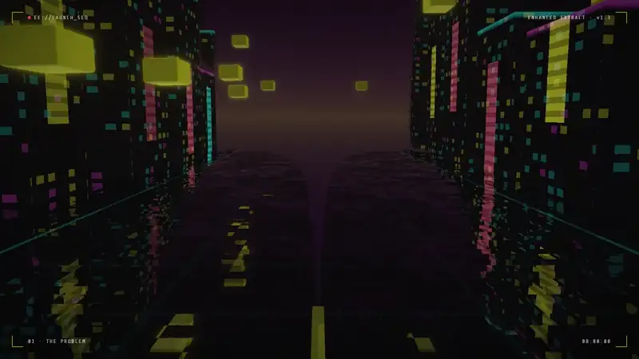
</div>

<a id="why"></a>

## `▚▚ 00` // WHY THIS EXISTS

You download a 24-part RAR set. To unpack it the usual way, every part has to stay on disk until the last file is written, so for a while you hold **the archive and the game at once**. ISOs are the same: setup reads the ISO while it installs the game beside it.

EnhancedExtract can reduce that peak. RAR safe mode keeps each file's parts until the file is fully written; early mode frees parts sooner and needs less room, but a stop can lose a file.

```text
 FREE SPACE NEEDED                        usual way      EnhancedExtract
 Ashen Tide . 24 RAR parts . 47.30 GB     53.10 GB  -->   7.77 GB
 Vigil of Ostra . ISO install             50.78 GB  -->   7.00 GB
                                          ---------------------------
                                          same games, about 85% less free space
```

<sub>Illustrative figures from the earlier launch film's demo library, not measured safe-mode requirements. Current figures come from <code>inspect</code> and the setup screens; file layout and deletion mode affect the RAR peak.</sub>

| | Usual way | EnhancedExtract |
|---|---|---|
| **RAR set, same drive** | room for the whole unpacked game, with every part still on disk | peak output growth minus parts eligible for deletion, plus 1 GiB margin; calculated separately for safe and early modes |
| **ISO install** | room for the whole install, with the full ISO still on disk | `5 GB buffer + 2 GB` margin `+ any growth past the ISO's size` |
| **Deleting RAR parts** | by hand, after it's done | safe: after every file in a part is extracted and flushed; early: as soon as the part is read |
| **If RAR extraction stops** | source archives remain | safe: rerun to resume; early: files spanning deleted parts may be unrecoverable, with a warning and checkbox before starting |
| **ZIP, 7z, TAR…** | the archive stays until you delete it | room for the unpacked files. 7-Zip cannot free anything while it reads, so with `--delete` the whole archive goes only after a verified, error-free extraction |

> [!NOTE]
> Space estimates come from [`extractor.space_needed`](extractor.py) and [`isocore.space_needed`](isocore.py), using the archive layout and your real drive. Safe deletion of a solid RAR set waits until extraction finishes, so it needs room for the whole output.


<a id="features"></a>

## `▚▚ 01` // FEATURES

<table>
<tr>
<td width="50%" valign="top">

### `▸` RAR sets
- Finds every multi-part set in a folder, flags **missing parts** before you start
- Verifies every checksum first (`-t`), so a corrupt download never costs you a part
- **Safe deletion**: keeps every part needed by an unfinished file, then flushes completed files before deleting their parts
- **Early deletion**: frees each part once read, with a separate warning about file loss if interrupted
- **Resume**: a journal beside the parts remembers the destination and completed files
- Passwords over **stdin**, never on a command line
- Extract to another drive with `--dest`, keep or drop the parts

### `▸` ZIP, 7z, TAR and more
- ZIP, 7z, TAR, GZ, BZ2, XZ, ZST, CAB, WIM and split sets (`.7z.001`, `.zip.001`, `.z01`) through **7-Zip**
- `.tar.gz` and friends unpack in one streamed pass, with no temporary tar
- Same screens, same commands (`archive inspect|verify|extract`), same JSON as RAR
- `--delete` removes the archive only after a verified, error-free extraction; a corrupt one is never touched

</td>
<td width="50%" valign="top">

### `▸` ISO installs
- Serves the ISO as a **WinFsp virtual drive** and runs `setup.exe` from it
- **Frees the ISO behind setup** (NTFS sparse file), keeping a safety buffer
- Unattended **Inno Setup** installs (`/VERYSILENT … /DIR=`)
- Optional delete of the ISO once setup reports success
- Reads that hit freed data fail loudly, never return zeros

</td>
</tr>
<tr>
<td width="50%" valign="top">

### `▸` Explorer
- **Right-click a RAR, ZIP, 7z, TAR…** for a submenu with three actions
- Compact quick-extract window, no dashboard
- Existing output is never overwritten: `Game`, `Game (2)`, `Game (3)`…
- Per-user, doesn't touch your default archive app

</td>
<td width="50%" valign="top">

### `▸` Terminal & agents
- [`cli.py`](cli.py): every input is a flag, nothing ever prompts
- `--json`: one object per line, the last line is always the `result`
- `--dry-run` everywhere, `--background` jobs, meaningful **exit codes**
- Every result carries `next`: the exact command to run next

</td>
</tr>
</table>


<a id="screens"></a>

## `▚▚ 02` // SCREENS

<p align="center">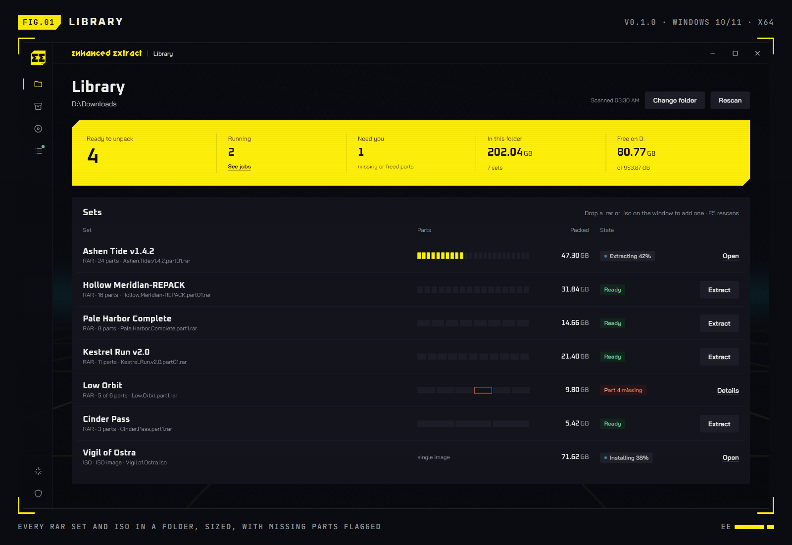</p>

<table>
<tr>
<td width="50%">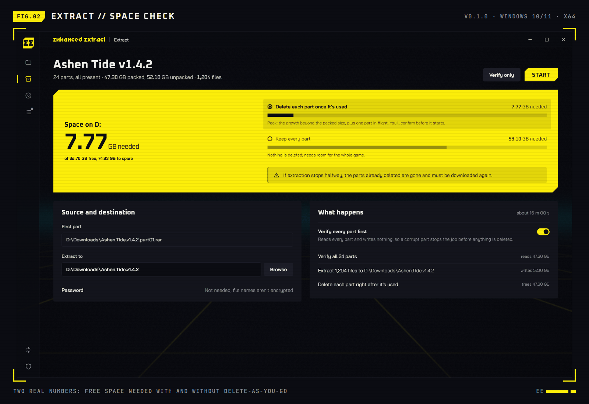</td>
<td width="50%">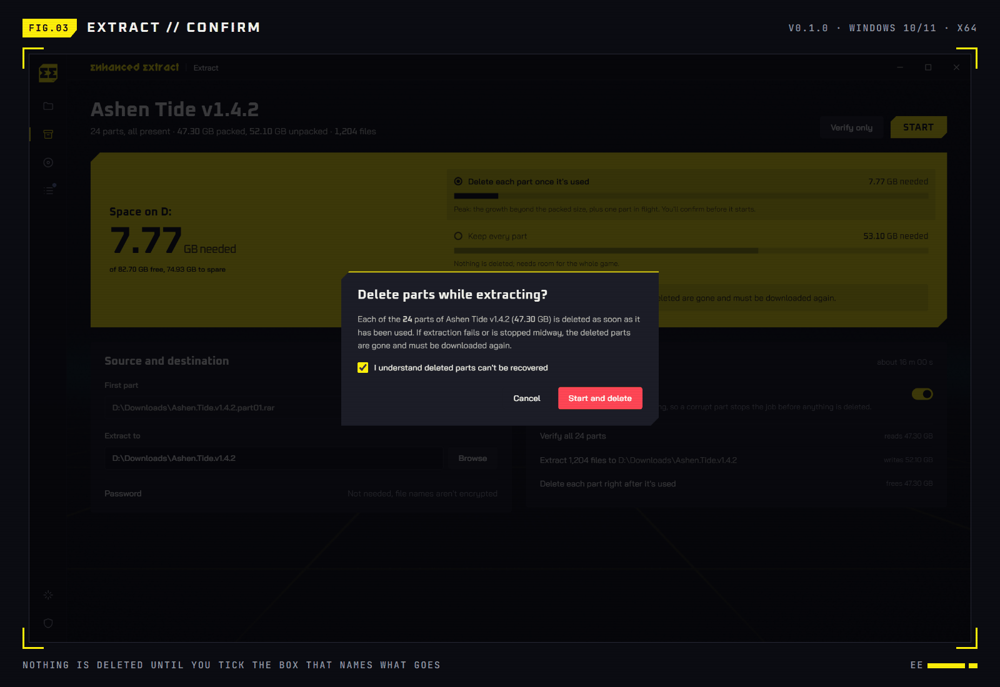</td>
</tr>
<tr>
<td width="50%">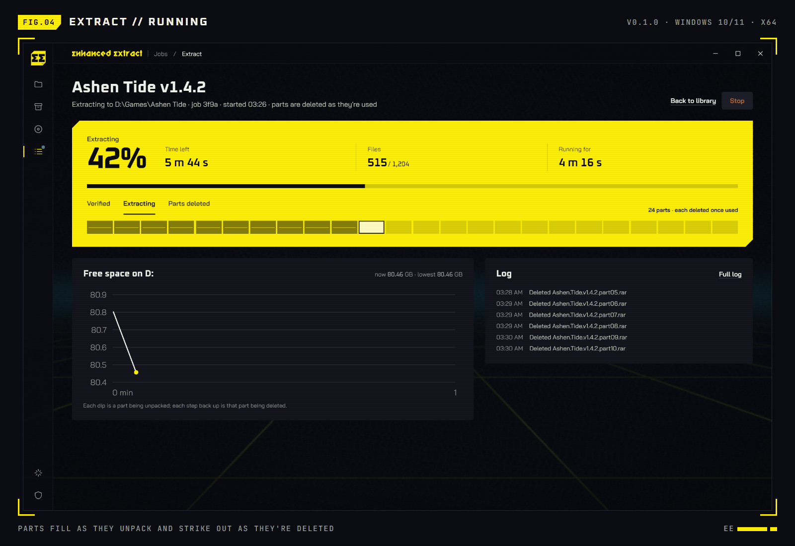</td>
<td width="50%">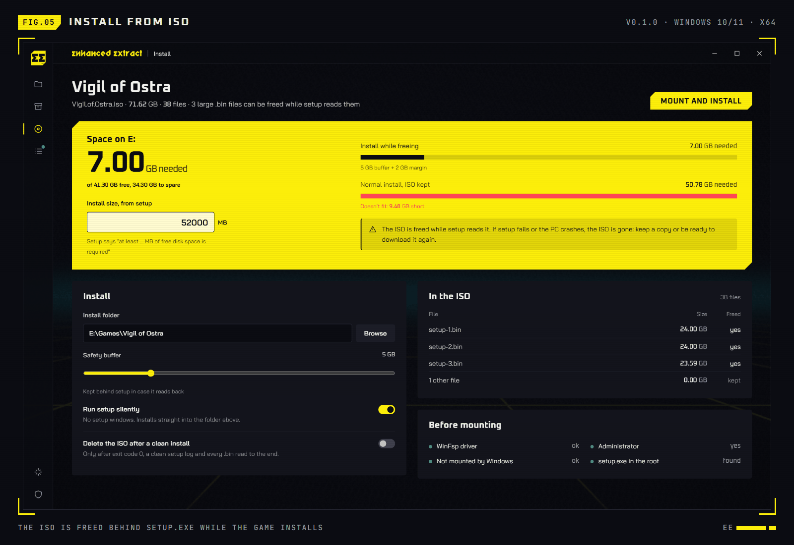</td>
</tr>
</table>

<details>
<summary><b><code>[+]</code> More screens: ISO running, Jobs</b></summary>
<br>
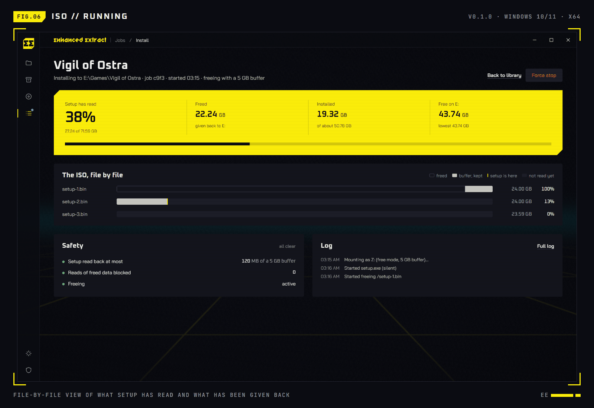
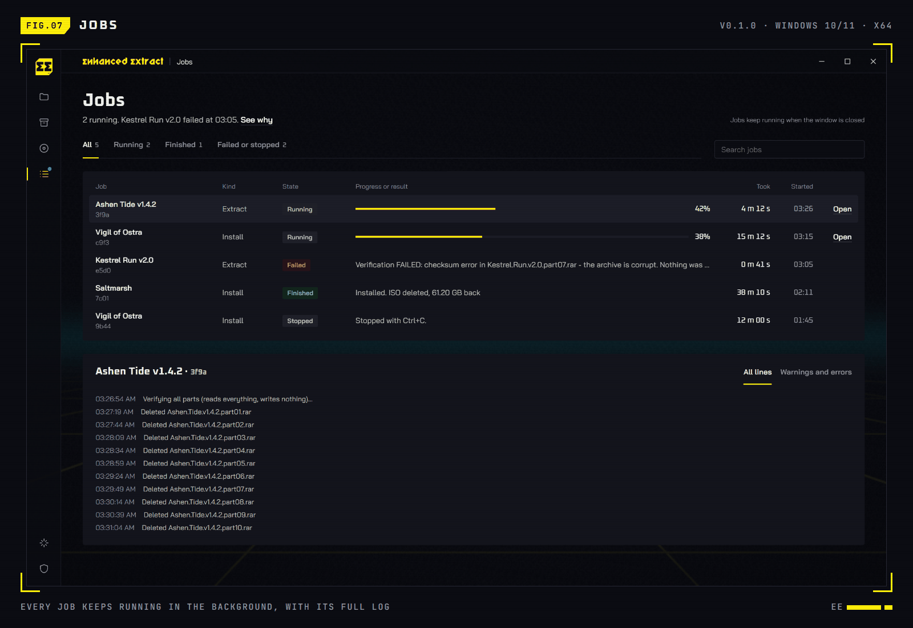
</details>

<sub>Dashboard screens are the real Tauri UI running on its built-in demo engine (`npm run dev`), so the game names and sizes are sample data. The Explorer and terminal captures further down are from a real run on a real archive.</sub>


<a id="install"></a>

## `▚▚ 03` // INSTALL

### What you need

| | Needed for | Comes with EnhancedExtract? |
|---|---|---|
| **Windows 10 / 11 x64** | everything | |
| **WebView2** | the desktop app | ships with Windows 11 and current Windows 10 |
| **UnRAR** | RAR sets | ✅ bundled. WinRAR's own copy is used first if WinRAR is installed |
| **7-Zip** | ZIP, 7z, TAR and the other formats | ✅ bundled (`deps/7zip`, LGPL). An installed 7-Zip is used first |
| **WinFsp** | ISO installs | ✅ installer bundled: `system install-winfsp` or the in-app button |
| **fusepy** | ISO installs, **from source only** | ✅ inside the packaged engine. From source: `pip install fusepy` |
| **Administrator** | ISO installs only (setup.exe elevates itself) | the app's shortcuts start it as admin; right-click extraction stays unelevated |

### Option A — Installer (recommended)

1. Download **`EnhancedExtract_0.1.2_x64-setup.exe`** from [**Releases**](https://github.com/gustavofring1483369/EnhancedExtract/releases).
2. Run it. It installs **for your user only**, no admin prompt, into `%LOCALAPPDATA%\EnhancedExtract`.
3. Open **EnhancedExtract** from the Start menu and point the Library at your downloads folder. For ISOs, the set-up screen's **Before mounting** checklist shows whether WinFsp and admin rights are in place.
4. Right-click any archive (`.rar`, `.zip`, `.7z`, `.tar.gz`…) → **Show more options** → **EnhancedExtract**.

> [!TIP]
> Uninstalling from *Settings → Apps* removes the app and only its own right-click entries.

### Option B — From source (desktop app)

```powershell
git clone https://github.com/gustavofring1483369/EnhancedExtract.git
cd EnhancedExtract
pip install pyinstaller fusepy          # engine build dependencies
build\build-engine.bat                  # -> build\dist\ee-engine\ee-engine.exe
cd ui
npm install
npm run tauri dev                       # the app, with the real engine
```

Needs **Node 20+**, the **Rust** toolchain (`rustup`, MSVC target) and the **MSVC C++ build tools**. To get an installer instead, run `npm run tauri build`: it lands in `ui\src-tauri\target\release\bundle\nsis\`.

### Option C — Terminal only

No build step. Python and WinRAR (or `UnRAR.exe`) are enough for RAR sets; 7-Zip (`7z.exe`, or the copy in `deps/7zip`) opens the other formats.

```powershell
git clone https://github.com/gustavofring1483369/EnhancedExtract.git
cd EnhancedExtract
python cli.py system check
```


<a id="quickstart"></a>

## `▚▚ 04` // QUICKSTART

The launch film's walkthrough: **5 steps + a shortcut**.

```text
 [01] OPEN YOUR DOWNLOADS   Library > Change folder > pick the folder your games
                            download into. Every RAR set and ISO shows up with
                            its size and state; missing parts are flagged before
                            you start. Or drop a .rar / .iso on the window.

 [02] CHECK THE SPACE       Pick a set. Compare safe deletion, early deletion,
                            and keeping every part using the engine's figures.
                            Keep "Verify every part first" on.

 [03] START                 Safe mode starts from the selected deletion option.
                            Early mode asks for a separate acknowledgement:
                            stopping can lose files whose parts were deleted.

 [04] LET IT RUN            Follow progress, time left, and files done. Close the
                            window anytime: the job keeps running. After a stop,
                            reopen the set or use Resume to continue.

 [05] INSTALL FROM AN ISO   Same idea for disc images: the ISO shrinks while setup
                            reads it. Type the size setup asks for ("At least ...
                            MB of free disk space is required"), then
                            Mount and install. Setup can run silently.

 [>>] SHORTCUT: R-CLICK     Right-click part 1 of any RAR set in Explorer >
                            EnhancedExtract > Extract, or Extract and free space.
                            No dashboard needed. Deleting still asks first.
```

> [!IMPORTANT]
> ISO installs need an **administrator** app window (setup.exe elevates itself and can't see a drive mounted by a normal process). The installed shortcuts already start the app as admin; from source, the ISO screen offers **Restart as admin**.

**Keys:** <kbd>Ctrl</kbd>+<kbd>O</kbd> opens an archive or `.iso` · <kbd>F5</kbd> rescans the Library · drag a file onto the window to set it up · **Effects** in the rail turns the animated backdrop off.


<a id="right-click"></a>

## `▚▚ 05` // RIGHT-CLICK EXTRACT

<div align="center">
  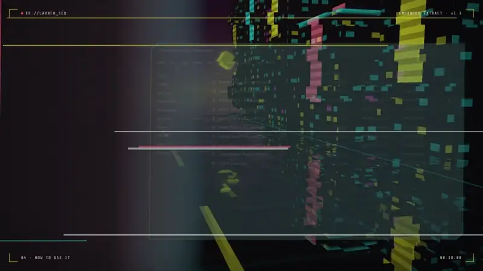
</div>

<br>

<p align="center">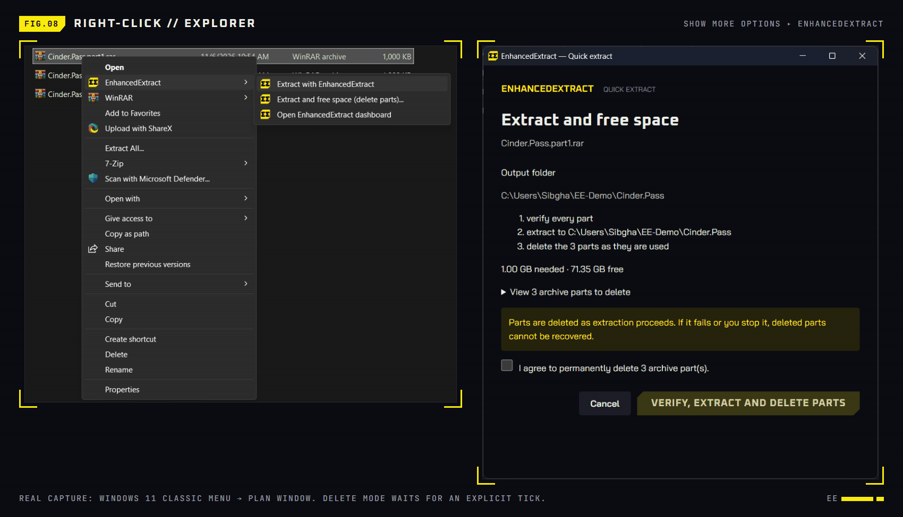</p>

The installer adds an **EnhancedExtract** submenu to every `.rar`, `.zip`, `.7z`, `.tar`, `.gz`, `.tgz`, `.bz2`, `.xz`, `.zst`, `.001`, `.cab` and `.wim` (Windows 11: **Show more options**, or <kbd>Shift</kbd>+right-click):

| Entry | What happens |
|---|---|
| **Extract with EnhancedExtract** | Verifies every part and extracts into a new folder beside the archive. **Keeps every part.** |
| **Extract and free space (delete parts)…** | Shows the output folder, engine space estimate, and parts to delete. Safe mode starts with **Extract & delete**. If only early deletion fits, a warning checkbox is required before **Delete early**. A stopped set opens its resume plan. |
| **Open with EnhancedExtract** | Opens the dashboard with that archive already loaded. |

<table>
<tr>
<td width="45%">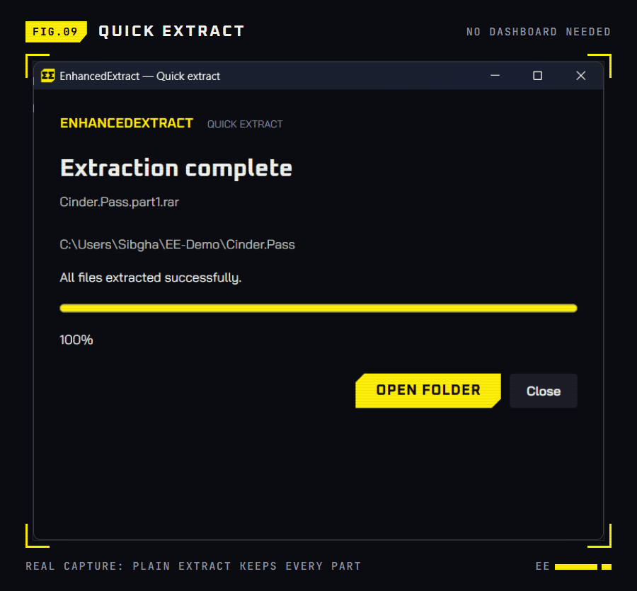</td>
<td valign="top">

- Pick **any** part; `.part07.rar` resolves to the first volume, zero-padded or not. `.7z.003` resolves to `.7z.001` and `.z02` to the `.zip`.
- Output never overwrites: `Game` exists → `Game (2)` → `Game (3)`.
- Password-protected? The window asks, and the password goes over stdin.
- Close the window and the job keeps running; the dashboard's **Jobs** screen follows it.
- A second window on the same archive is refused while one is open.
- Registered per user under `HKCU\Software\Classes\SystemFileAssociations\<.ext>\shell\EnhancedExtract`. Your default archive app is untouched.

</td>
</tr>
</table>

The same actions from a script:

```powershell
& "$env:LOCALAPPDATA\EnhancedExtract\enhancedextract-ui.exe" --shell-extract        "D:\Downloads\Game.part1.rar"
& "$env:LOCALAPPDATA\EnhancedExtract\enhancedextract-ui.exe" --shell-extract-delete "D:\Downloads\Game.part1.rar"   # still asks
```


<a id="cli"></a>

## `▚▚ 06` // CLI

<p align="center">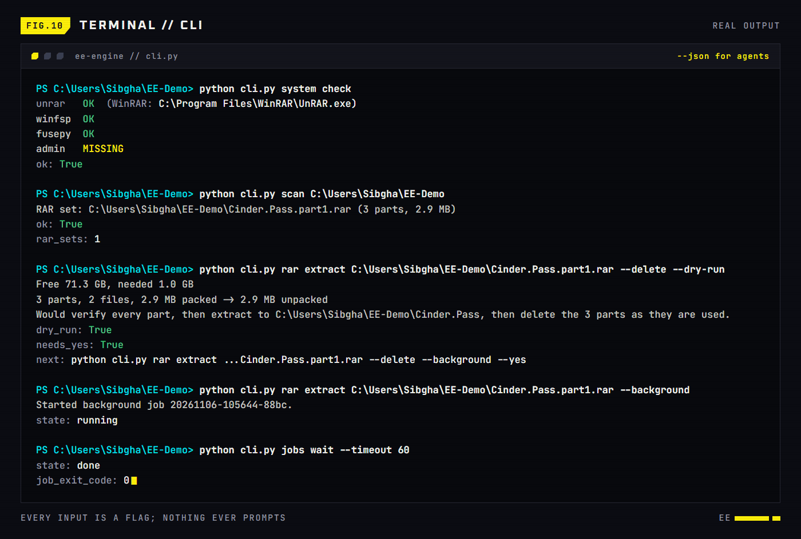</p>

<table>
<tr>
<td width="58%">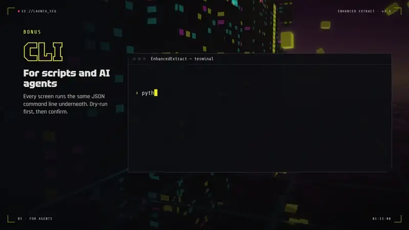</td>
<td valign="top">

**Automate extraction with commands**

You can use terminal commands to run the same tasks as the desktop app. Scripts and AI tools can read the results in a structured format called JSON, shown below. Use `--dry-run` to preview the steps without changing any files. If the steps include deleting files, review the plan before adding `--yes` to approve it.

```text
{"type": "plan", "steps": [...]}
{"type": "result", "ok": true,
 "exit_code": 0, "next": "... --yes"}
```

</td>
</tr>
</table>

```text
                        ___     |  every input is a flag . nothing ever prompts
  ___  ___        _____/ (_)    |  --json      one object per line, result last
 / _ \/ _ \______/ ___/ / /     |  --dry-run   the plan, nothing changes
/  __/  __/_____/ /__/ / /      |  --background  jobs that outlive your shell
\___/\___/      \___/_/_/       |  exit codes  0 ok . 6 needs --yes . 7 still running
```

The engine is a plain command-line program. The desktop app is just one of its callers.

```powershell
python cli.py <group> <command> [flags]                 # from source
ee-engine.exe --cli <group> <command> [flags]           # engine shipped with the desktop app
```

### The loop

```powershell
python cli.py scan D:\Downloads                                         # 1. find archives and ISOs
python cli.py archive inspect D:\Downloads\Game.part1.rar --delete      # 2. sizes, space, `next` (RAR, zip, 7z, tar ...)
python cli.py archive extract D:\Downloads\Game.part1.rar --delete --dry-run   # 3. the plan, nothing changes
python cli.py archive extract D:\Downloads\Game.part1.rar --delete --yes --background   # 4. go
python cli.py jobs wait --timeout 60                                    # 5. repeat while exit code is 7
```

### Commands

<details open>
<summary><b><code>system</code></b> — what this PC has</summary>

| Command | Does | Flags |
|---|---|---|
| `system check` | UnRAR, 7-Zip, WinFsp, fusepy, admin rights | |
| `system install-winfsp` | installs the bundled WinFsp driver (admin; no-op if present) | `--dry-run` |
| `system install-fusepy` | `pip install fusepy` into this Python (no-op if present) | `--dry-run` |

</details>

<details open>
<summary><b><code>scan</code></b> · <b><code>schema</code></b> — find work, describe yourself</summary>

| Command | Does | Flags |
|---|---|---|
| `scan FOLDER` | lists RAR sets (first parts), other archives (zip, 7z, tar…) and ISOs; reads no archive | `--depth N` (default 2) |
| `schema` | every command, flag, example and exit code as one JSON document (~10 KB) | |

</details>

<details open>
<summary><b><code>archive</code></b> · <b><code>rar</code></b> — RAR sets, ZIP, 7z, TAR and more (<code>rar</code> runs the same commands)</summary>

| Command | Does |
|---|---|
| `archive inspect ARCHIVE` | parts, sizes and the free space an extract needs. RAR goes to UnRAR, everything else to 7-Zip |
| `archive verify ARCHIVE` | tests every part's checksums; writes nothing |
| `archive extract ARCHIVE` | verifies, then extracts; for RAR `--delete` uses safe deletion and a resume journal, for other formats it removes the archive after a clean extraction |

| Flag | On | Meaning |
|---|---|---|
| `--dest DIR` | inspect, extract | output folder (default: beside the archive, named after it) |
| `--delete` | inspect, extract | RAR: safe mode, delete a part once every file in it is extracted and flushed. Other formats: delete the whole archive after a clean extraction |
| `--early-delete` | inspect, extract | RAR only: with `--delete`, free each part as soon as it is read; interruption may lose files spanning deleted parts |
| `--no-verify` | extract | skip the checksum pass |
| `--ignore-space` | extract | start even if free space looks too low |
| `--dry-run` | extract | check everything, print the `plan`, change nothing |
| `--yes` | extract | confirm `--delete` |
| `--background` | verify, extract | return a job id at once; follow with `jobs` |
| `--password-stdin` | all | read the password from the first stdin line (preferred) |
| `--password PW` | all | visible to other programs; prefer the above or `EE_PASSWORD` |

</details>

<details open>
<summary><b><code>iso</code></b> — install a game from an ISO</summary>

| Command | Does |
|---|---|
| `iso status ISO` | quickly reports whether Windows has this ISO mounted and whether it still exists |
| `iso inspect ISO` | files in the ISO and the free space an install needs (`--install-size-mb`, `--buffer-gb`, `--files`) |
| `iso install ISO` | mounts the ISO, runs setup.exe, frees the ISO behind it **(admin terminal)** |
| `iso delete ISO` | deletes the ISO and its freeing record (`--dry-run`, `--yes`; no-op if gone) |

| `iso install` flag | Meaning |
|---|---|
| `--install-dir DIR` | where setup installs (required unless `--no-free`) |
| `--install-size-mb N` | from setup's *"At least … MB of free disk space is required"* |
| `--buffer-gb N` | GB of ISO kept behind setup (default 5, minimum 1) |
| `--silent` | unattended Inno Setup: `/VERYSILENT /SUPPRESSMSGBOXES /NORESTART /SP- /DIR=<install-dir>` |
| `--setup-arg ARG` | extra argument for setup.exe (repeatable) |
| `--delete-iso` | delete the ISO if setup fully succeeded |
| `--no-free` | serve the ISO and log reads, free nothing |
| `--no-setup` | only mount; `jobs stop` (or `quit` on stdin) unmounts |
| `--status-every S` | seconds between status lines (default 10) |
| `--dry-run` · `--yes` · `--background` | as above; `--yes` confirms freeing and `--delete-iso` |

</details>

<details open>
<summary><b><code>jobs</code></b> — follow <code>--background</code> work</summary>

| Command | Does | Flags |
|---|---|---|
| `jobs list` | recent jobs, newest first | `--limit N` |
| `jobs status [ID]` | where a job stands (exit 7 while running) | |
| `jobs wait [ID]` | wait until it ends or the timeout passes | `--timeout S` (default 60) |
| `jobs logs [ID]` | the job's events | `--tail N` (0 = all), `--type warning error …` |
| `jobs stop [ID]` | stop cleanly, like Ctrl+C (kills UnRAR / unmounts) | `--force` |

`ID` is optional (newest job) and can be any unique part of the id.

</details>

**Global flags:** `--json` (or `EE_JSON=1`) · `-q/--quiet` · `-v/--verbose` (log every file UnRAR touches) · `--progress-every S` (default 2) · `--version`. Flags must be written in full (`--dry-run`, not `--dry`).

### Resume a stopped RAR extraction

Safe and early delete runs keep `<set>.ee-resume.json` beside the archive parts. Keep this journal and the original output folder. Run the same command again, or select any remaining part in Explorer. The engine uses the original destination, skips files recorded as complete, and verifies the remaining files before extracting. The dashboard locks the destination and shows **Resume**.

```powershell
# Review the resume plan first; part 1 may already have been deleted
python cli.py --json rar extract "D:\Downloads\Game.part3.rar" --delete --dry-run
# After approving the plan
python cli.py --json rar extract "D:\Downloads\Game.part3.rar" --delete --yes --background
```

An interrupted early-mode run reports unrecoverable files in `lost`; resuming cannot restore their deleted source parts. A failed or stopped delete run reports `resumable` when a journal remains. The journal is removed after all archive parts have been deleted. Do not move, replace, or edit the output files while relying on resume.

### Recipes

```powershell
# Extract to another drive, keep the parts
python cli.py rar extract "D:\Downloads\Game.part1.rar" --dest "E:\Games\Game"

# Password from a file, freeing space as it goes
Get-Content pw.txt | python cli.py rar extract Game.part1.rar --delete --yes --password-stdin

# Unattended ISO install that deletes the ISO afterwards (admin PowerShell)
python cli.py iso install Game.iso --install-dir "D:\Games\Game" --install-size-mb 52000 --silent --delete-iso --yes --background

# Just mount an ISO as a drive; unmount with `jobs stop`
python cli.py iso install Game.iso --no-free --no-setup --background
```

### Exit codes

| Code | Meaning | What to do |
|:---:|---|---|
| `0` | success, or already done (`already_done: true`) | |
| `1` | the job failed | read `error` |
| `2` | bad arguments or input | run `fix` |
| `3` | password needed or wrong | supply the password |
| `4` | not enough free space | compare `needed` and `free` |
| `5` | UnRAR, 7-Zip, WinFsp, fusepy or admin rights missing | `system check`, follow the hints |
| `6` | a destructive step needs `--yes` | review the plan, then run `fix` |
| `7` | job still running (`jobs wait` timed out) | wait again |
| `130` | Ctrl+C / `jobs stop` | |

### For AI agents and scripts

<details>
<summary><b><code>[+]</code> The JSON contract</b></summary>
<br>

With `--json`, every stdout line is one object with `type` and `ts`. The **last line is always the result**:

```json
{"type": "result", "ts": 1793937388.134, "exit_code": 6, "schema": 2, "ok": false,
 "error": "--delete removes each part once it is extracted; if extraction fails midway, the deleted parts are gone.",
 "fix": "python cli.py --json rar extract C:\\Users\\Sibgha\\EE-Demo\\Cinder.Pass.part1.rar --delete --yes",
 "duration_s": 0.1}
```

- Progress is throttled (every 2 s) with `overall` %, `eta_s` and `files_done`. UnRAR's per-file output is counted, not printed.
- Failures carry `error` and usually `fix`, a command line that gets past the problem.
- Inspects, dry runs and job results carry `next`.
- Retrying is safe: a finished `rar extract --delete` or `iso delete` reports `already_done`.
- Background jobs get passwords through their environment, never their command line.

**Rule for agents:** never add `--yes` on your own. Run the `--dry-run`, show the human the `plan`, and only then confirm. The full brief lives in [`AGENTS.md`](AGENTS.md).

</details>


<a id="safety"></a>

## `▚▚ 07` // SAFETY MODEL

> [!WARNING]
> **Deleted source parts cannot be restored.** Safe mode retains the parts needed to finish each file, allowing a stopped extraction to resume. Early mode deletes sooner: interruption can lose files spanning deleted parts. ISO freeing also changes the source image irreversibly.

- **Verify first.** Every part's checksum is tested before the first byte is extracted or the first part deleted (unless you pass `--no-verify`).
- **Named consent.** The compact GUI shows the deletion plan and requires an explicit start; early deletion also needs a checkbox. The dashboard labels all three choices and confirms early deletion separately. The CLI refuses deletion with exit `6` until `--yes`. Agents must show the dry-run plan and obtain approval first.
- **Safe mode waits for files.** At volume boundaries, a part becomes eligible only when every file in it is complete. Completed output files are flushed and recorded in the journal before their source parts are deleted. Solid sets retain all parts until the end.
- **Early mode frees closed parts immediately.** Its lower space estimate comes with the risk of unrecoverable files after interruption; resume reports those files explicitly.
- **No silent overwrites.** Quick-extract always reserves a fresh output folder.
- **ISO freeing is conservative.** Only big `.bin` files, never the head or tail of a file, never more than has been written to the install folder, and a backwards seek past half the buffer stops freeing for good.
- **Stopping mid-setup** only warns; `jobs stop --force` unmounts anyway (setup then fails, and in free mode the ISO is lost).


<a id="how-it-works"></a>

## `▚▚ 08` // HOW IT WORKS

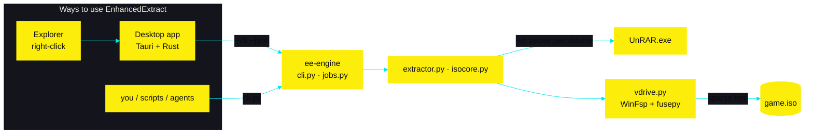

<details>
<summary><b><code>[+]</code> RAR: delete-as-you-go</b></summary>
<br>

UnRAR runs with `-vp`, which makes it **pause before opening each next volume**. Safe mode checks the file layout at that boundary, retains parts containing unfinished files, flushes completed files, and writes the resume journal atomically before deleting eligible parts. Early mode deletes each closed part immediately. The space estimator replays output growth and eligible deletions across the volumes, then adds a 1 GiB margin. A solid archive retains every part until extraction finishes in safe mode. UnRAR output is requested as UTF-8 (`-scfr`) so non-ASCII paths survive.

</details>

<details>
<summary><b><code>[+]</code> ISO: freeing behind setup</b></summary>
<br>

`vdrive.py` serves the ISO's files through **WinFsp** as a drive letter and logs every read. In free mode it **releases ISO sections setup has finished with**, using NTFS sparse files, when all of these hold:

- only big `.bin` files are freed
- at least `BUFFER` bytes behind the furthest point read in that file
- never the first 16 MB or the last 64 MB of a file
- total freed never exceeds bytes written to the install folder minus a margin, so a read-only verify pass frees nothing
- setup going back by less than half the buffer is fine; going back further stops freeing for good

A read that touches freed data **fails with an I/O error** instead of returning zeros, so setup can never install corrupted files silently.

</details>

<details>
<summary><b><code>[+]</code> Repository layout</b></summary>
<br>

```text
EnhancedExtract/
├─ cli.py            terminal front end: every command, --json, jobs, exit codes
├─ engine.py         entry point of ee-engine (CLI + virtual drive)
├─ extractor.py      RAR: list, verify, extract, delete-as-you-go
├─ sevenzip.py       everything else (zip, 7z, tar ...) through 7-Zip
├─ isocore.py        ISO: checks, space maths, virtual drive process, setup verdict
├─ vdrive.py         WinFsp filesystem that frees the ISO behind setup
├─ sparse.py         NTFS sparse-file helpers
├─ udf.py            reads UDF ISOs without mounting
├─ jobs.py           detached background jobs and their logs
├─ ui/               Tauri 2 desktop app (React 19, Vite, Rust)
│  ├─ src/              screens, quick-extract window, motion
│  └─ src-tauri/        engine bridge, shell integration, NSIS hooks
├─ build/            build scripts and packaging for ee-engine
├─ deps/             bundled WinFsp installer, fusepy package
├─ tests/            unittest suite for the CLI
└─ AGENTS.md         the brief for coding agents
```

</details>


<a id="build"></a>

## `▚▚ 09` // BUILD & TEST

### Landing page (Cloudflare Pages)

The responsive landing page lives in [`site/`](site/) and is deployed at [enhancedextract.pages.dev](https://enhancedextract.pages.dev/). To publish updates, authenticate with `npx wrangler login` once, then run:

```powershell
npx wrangler pages deploy site --project-name enhancedextract --branch main
```

The launch-film sources and renders are in [`videos/ee-launch`](videos/ee-launch/).
MP4 renders use Git LFS; run `git lfs install` before cloning, or `git lfs pull` in an
existing checkout to download them. Local HyperFrames preview caches are ignored.

```powershell
# engine (PyInstaller folder build, bundles UnRAR.exe, 7-Zip and the WinFsp installer)
build\build-engine.bat

# desktop app + NSIS installer
cd ui
npm install
npm run build              # typecheck + Vite
npm run tauri build        # -> src-tauri\target\release\bundle\nsis\EnhancedExtract_0.1.2_x64-setup.exe
cd ..
python build/package-release.py   # installer, CLI ZIP, notices and SHA256SUMS in build/dist/release-0.1.2

# browser-only UI preview with a mock engine (no Rust needed): http://localhost:1420
npm run dev                # #rar #rarJob #iso #isoJob #jobs open a screen directly
```

```powershell
python -m unittest discover -s tests      # engine + CLI (RAR tests need WinRAR; other-format tests need 7-Zip; ISO job test needs WinFsp + fusepy)
cd ui\src-tauri; cargo test --lib         # engine bridge + Explorer integration
```

<details>
<summary><b><code>[+]</code> Environment variables</b></summary>
<br>

| Variable | Effect |
|---|---|
| `EE_JSON=1` | same as `--json` |
| `EE_PASSWORD` | archive password (instead of `--password`) |
| `EE_DATA_DIR` | where jobs and logs live (default: next to the source, or `%LOCALAPPDATA%\EnhancedExtract` when packaged) |
| `EE_ENGINE` | desktop app: path to an engine exe to use |
| `EE_PYTHON` | Python interpreter used by the engine bridge during development |

</details>


<a id="faq"></a>

## `▚▚ 10` // FAQ & TROUBLESHOOTING

<details>
<summary><b>I don't see EnhancedExtract when I right-click a .rar</b></summary>
<br>

On Windows 11 the entries are in the classic menu: **Show more options**, or hold <kbd>Shift</kbd> while right-clicking. They're registered for the supported archive types (`.rar`, `.zip`, `.7z`, `.tar`, `.gz`, `.001` and more) and only for the user who ran the installer.
</details>

<details>
<summary><b>"admin MISSING" in <code>system check</code></b></summary>
<br>

Only ISO installs need it. Extracting archives never does. Start the app from its shortcut (it runs as admin) or use an administrator terminal for `iso install`.
</details>

<details>
<summary><b>Exit code 4: not enough free space</b></summary>
<br>

The result carries `needed` and `free`. For RAR deletion it also carries `needed_safe`, `needed_early`, and `early_fits`. If only early deletion fits, the error suggests `--early-delete`; review its file-loss warning before using it. You can also choose another destination drive, or lower `--buffer-gb` for ISOs (minimum 1). `--ignore-space` bypasses the check at your own risk.
</details>

<details>
<summary><b>A part is missing or corrupt</b></summary>
<br>

The Library marks missing parts in red before you start, and verification (`rar verify`) catches bad checksums before anything is deleted. Re-download the named part and run again.
</details>

<details>
<summary><b>Does it support ZIP / 7z?</b></summary>
<br>

Yes. Version 0.1.2 supports ZIP, 7z, TAR, GZ, BZ2, XZ, ZST, CAB, WIM and other 7-Zip formats, including split sets. RAR uses UnRAR; other formats use the bundled 7-Zip. For ZIP/7z/TAR, source archives are kept until extraction finishes cleanly. RAR-style incremental deletion and journal-based resume apply only to RAR.
</details>

<details>
<summary><b>Can I close the window while it runs?</b></summary>
<br>

Yes. Long work always runs as a detached engine job. Reopen the app and the **Jobs** screen (or `python cli.py jobs list`) picks it back up.
</details>


## `▚▚ 11` // CREDITS

- **[UnRAR](https://www.rarlab.com/)** by Alexander Roshal / RARLAB, freeware, redistributed as permitted by its license.
- **[7-Zip](https://www.7-zip.org/)** by Igor Pavlov. Its DLL, executable and licence notice are bundled for non-RAR archives. See [third-party notices](docs/THIRD_PARTY_NOTICES.txt).
- **[WinFsp](https://winfsp.dev/)** by Bill Zissimopoulos, and **[fusepy](https://github.com/fusepy/fusepy)**.
- **[Tauri](https://tauri.app/)**, **[React](https://react.dev/)**, **[Vite](https://vite.dev/)**.
- Type: **Oxanium**, **Bai Jamjuree** and **Rajdhani**, all under the SIL Open Font License ([`fonts/OFL.txt`](fonts/OFL.txt)).
- UI sounds from **[Kenney](https://kenney.nl/)** (CC0) and **[Pixabay](https://pixabay.com/)** contributors (Pixabay Content License).

## `▚▚ 12` // CONTRIBUTING

EnhancedExtract is open source and contributions are welcome: bug reports, fixes, tests and docs.

- Read **[CONTRIBUTING.md](CONTRIBUTING.md)** for setup, tests and how to open a pull request.
- Found a bug or have an idea? [Open an issue](https://github.com/gustavofring1483369/EnhancedExtract/issues/new/choose). Questions go to [Discussions](https://github.com/gustavofring1483369/EnhancedExtract/discussions).
- Security problems: report them privately, see **[SECURITY.md](SECURITY.md)**.
- Everyone taking part follows the **[Code of Conduct](CODE_OF_CONDUCT.md)**.

## `▚▚ 13` // LICENSE

EnhancedExtract is open source under the [MIT License](LICENSE). Copyright (c) 2026 Sibgha Alfirdausi Rambe.

Bundled third-party components keep their own licenses: UnRAR (RARLAB freeware licence), 7-Zip (LGPL, with the unRAR restriction), WinFsp (GPLv3 with a FLOSS exception), fusepy (ISC), the fonts (SIL OFL) and the UI sounds (Kenney CC0, Pixabay Content License). See [third-party notices](docs/THIRD_PARTY_NOTICES.txt). The landing page in `site/` also uses GSAP under GreenSock's own licence.

<br>

<div align="center">

```text
 >> EOF ===================================== BIG GAMES. SMALL DRIVES. ==//
```

<sub>Made by <a href="https://github.com/gustavofring1483369">Sibgha Alfirdausi Rambe</a> · <a href="#readme">back to top ↑</a></sub>

</div>
